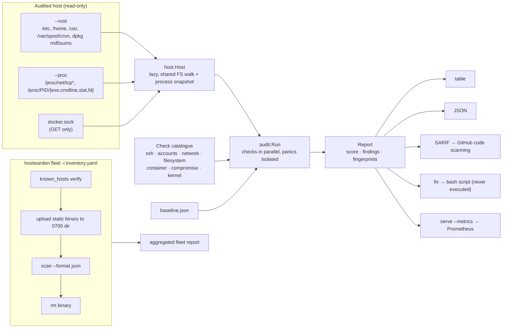

# hostwarden

[](https://github.com/RatulSikder97/hostwarden/actions/workflows/ci.yml)
[](go.mod)
[](LICENSE)

**A single static binary that audits a Linux server and tells you whether it is already compromised.**

Most hardening scanners stop at "is `PasswordAuthentication` off?". hostwarden also asks the
questions you ask at 2 a.m. during an incident: *is there a miner running from a deleted binary
in `/tmp`? who added that SSH key yesterday? why does `ps` not match its package checksum?
what is re-downloading the payload every five minutes?*

The checks come from real incidents: an unauthenticated Redis and a Docker API on `0.0.0.0`
used as the way in, a leaked deploy key, and a crypto-miner dropped through an RCE in a container
that came back after every `kill` because of a cron job and a fake `system-update.service`.

- **39 checks** across SSH, accounts, network exposure, filesystem, Docker, kernel and patching,
  including **11 compromise indicators** (miners, persistence, trojaned binaries, fileless execution).
- **Read-only by design.** No remediation runs, ever. `hostwarden fix` prints a reviewable script.
- **Testable.** Every check reads through a configurable `--root` and `--proc`, so it runs
  against fixture filesystems in unit tests and against mounted disk images during forensics.
- **CI-native.** Table, JSON and SARIF output, a 0-100 score, `--fail-on` exit codes and a
  baseline file for accepted risk.
- **Fleet mode** over SSH with mandatory `known_hosts` verification, and a **Prometheus exporter**.

## How it works



A check is a plain struct (the `analysis.Analyzer` pattern) with an ID, default severity,
CIS-style rationale, remediation, an optional fix snippet and a `Run` function:

```go
audit.Check{
    ID:          "HW-IOC-001",
    Title:       "Global library preload configured",
    Category:    audit.CategoryCompromise,
    Severity:    audit.Critical,
    Rationale:   "/etc/ld.so.preload is the standard hiding place for userland rootkits ...",
    Remediation: "Treat the host as compromised: capture the library, remove the entry, rebuild.",
    Run:         runPreload, // func(ctx, *host.Host) ([]audit.Finding, error)
}
```

`Run` returns findings with a target and evidence; the runner fills in metadata, computes a stable
fingerprint (`sha256(check, target)`) for baselines and SARIF, and records checks that do not apply
(`audit.Skip`) separately from checks that failed.

## Quick start

```bash
go install github.com/RatulSikder97/hostwarden/cmd/hostwarden@latest   # or grab a release archive
sudo hostwarden scan                         # human table
sudo hostwarden scan --verbose               # ... with evidence lines
sudo hostwarden scan --format json > report.json
sudo hostwarden scan --format sarif --output hostwarden.sarif
sudo hostwarden fix > remediation.sh         # review, then run it yourself
hostwarden checks                            # list the catalogue
```

Run as root: reading `/etc/shadow`, other users' `/proc/PID/exe` and the Docker socket requires it.
Without root, unreadable sources are skipped rather than failing the scan.

Scan the host from a container (no install on the host):

```bash
docker build -t hostwarden .
docker run --rm --pid=host --network=host -v /:/host:ro hostwarden   # = scan --root /host --proc /proc
```

`--pid=host` exposes host processes in `/proc`, `--network=host` exposes the host socket tables,
and the host's `/run/docker.sock` is found under `/host` automatically.

Offline forensics on a mounted disk image works the same way: `hostwarden scan --root /mnt/evidence`
(process and socket checks are skipped when there is no procfs).

## Sample output

Real output from the integration test, which runs hostwarden inside the deliberately compromised
container defined in [`test/Dockerfile`](test/Dockerfile) (Redis on `0.0.0.0`, a UID 0 backdoor, a
cron dropper, a fake `system-update.service`, a trojaned `ps`, and a stand-in miner that launches
from a hidden `/tmp` directory, deletes its binary and holds a "stratum" connection on port 3333):

```text
hostwarden integration  972fb49a5960 · Debian GNU/Linux 12 (bookworm) · root=/

SEVERITY  CHECK       TARGET                                        FINDING
CRITICAL  HW-ACC-001  user:toor                                     account "toor" has UID 0
CRITICAL  HW-ACC-002  user:deploy                                   account "deploy" has an empty password field
CRITICAL  HW-CTR-002  /etc/docker/daemon.json                       Docker API served on tcp://0.0.0.0:2375 without TLS client verification
CRITICAL  HW-FS-002   /tmp/.ICE-unix/.s                             /tmp/.ICE-unix/.s (urwxr-xr-x): setuid/setgid binary in a user-writable location (classic root pers…
CRITICAL  HW-FS-004   /etc/shadow                                   /etc/shadow has mode 0644
CRITICAL  HW-FS-005   /home/deploy/.ssh/id_ed25519                  private key /home/deploy/.ssh/id_ed25519 is readable by group/others (mode 0644)
CRITICAL  HW-IOC-007  pid:12                                        kdevtmpfsi (pid 12) looks like a crypto-miner: process name matches a known miner; command line ref…
CRITICAL  HW-NET-001  tcp/0.0.0.0:6379                              Redis port 6379 bound to 0.0.0.0 (all interfaces) by redis-server (pid 34)
HIGH      HW-ACC-003  /etc/sudoers.d/90-deploy:1                    deploy: passwordless sudo for ALL commands (root-equivalent)
HIGH      HW-IOC-002  /etc/cron.d/sysupdate:1                       /etc/cron.d/sysupdate: downloads a remote script and pipes it to a shell
HIGH      HW-IOC-002  /var/spool/cron/crontabs/www-data:1           /var/spool/cron/crontabs/www-data: executes from a world-writable directory; references a known cry…
HIGH      HW-IOC-003  /etc/systemd/system/system-update.service:4   /etc/systemd/system/system-update.service: decodes an embedded base64 payload
HIGH      HW-IOC-005  pid:12                                        kdevtmpfsi (pid 12) runs from a deleted binary /tmp/.X11-unix/.x/kdevtmpfsi
HIGH      HW-IOC-006  pid:12                                        kdevtmpfsi (pid 12) executes from world-writable location /tmp/.X11-unix/.x
HIGH      HW-IOC-008  tcp/127.0.0.1:55622->127.0.0.1:3333           kdevtmpfsi (pid 12) has an established connection to 127.0.0.1:3333, a common stratum mining-pool p…
HIGH      HW-IOC-011  /bin/ps                                       /bin/ps does not match the checksum recorded by package procps
HIGH      HW-SSH-001  /etc/ssh/sshd_config.d/50-cloud-init.conf     effective PasswordAuthentication is "yes"
HIGH      HW-SSH-002  /etc/ssh/sshd_config.d/50-cloud-init.conf     effective PermitRootLogin is "yes"
MEDIUM    HW-CTR-003  user:deploy                                   user "deploy" is in the docker group and is effectively root
MEDIUM    HW-FS-001   /srv/uploads                                  /srv/uploads is world-writable without the sticky bit (drwxrwxrwx)
MEDIUM    HW-IOC-009  /usr/bin                                      1 binary in /usr/bin modified within the last 72h0m0s
MEDIUM    HW-IOC-010  /root/.ssh/authorized_keys                    /root/.ssh/authorized_keys was modified 7s ago
MEDIUM    HW-NET-002  host-firewall                                 no enabled nftables, iptables, ufw or firewalld configuration found
MEDIUM    HW-SSH-003  /etc/ssh/sshd_config.d/50-cloud-init.conf#C…  Ciphers enables weak algorithms: aes256-cbc
MEDIUM    HW-SSH-003  /etc/ssh/sshd_config.d/50-cloud-init.conf#M…  MACs enables weak algorithms: hmac-sha1
LOW       HW-ACC-004  user:www-data                                 system account "www-data" (uid 33) has shell /bin/bash
LOW       HW-FS-003   /tmp                                          /tmp is not a separate mount, so noexec/nosuid cannot be enforced
LOW       HW-KRN-001  kernel.kptr_restrict                          kernel.kptr_restrict = 0 (expected >=1)
LOW       HW-KRN-001  kernel.unprivileged_bpf_disabled              kernel.unprivileged_bpf_disabled = 0 (expected >=1)
LOW       HW-KRN-001  net.ipv4.conf.all.log_martians                net.ipv4.conf.all.log_martians = 0 (expected 1)
LOW       HW-KRN-001  net.ipv4.conf.all.send_redirects              net.ipv4.conf.all.send_redirects = 1 (expected 0)
LOW       HW-KRN-002  unattended-upgrades                           unattended-upgrades is not installed or APT::Periodic::Unattended-Upgrade is not enabled
LOW       HW-SSH-004  /etc/ssh/sshd_config.d/50-cloud-init.conf     effective MaxAuthTries is "10"

Score 0/100 (F)   8 critical · 10 high · 7 medium · 8 low
39 checks · 5 skipped · 0 errors · 0 suppressed · 325ms
```

CI uploads the same scan as SARIF to this repository's code scanning tab
(`sarif-demo` job), so each finding shows up as an alert with its rule help.

## Check catalogue

Generated with `hostwarden checks --format markdown`. Severity is the default; individual
findings escalate or de-escalate (for example, a setuid binary in `/tmp` is critical, a deleted
binary under `/usr` that is just awaiting a restart after an upgrade is low).

| ID | Severity | Category | What it detects |
|---|---|---|---|
| `HW-SSH-001` | high | ssh | SSH password authentication enabled |
| `HW-SSH-002` | high | ssh | SSH root login permitted |
| `HW-SSH-003` | medium | ssh | Weak SSH ciphers, MACs or key exchange algorithms |
| `HW-SSH-004` | low | ssh | SSH MaxAuthTries too high |
| `HW-SSH-005` | critical | ssh | SSH permits empty passwords |
| `HW-SSH-006` | medium | ssh | Weak or loosely protected authorized_keys |
| `HW-ACC-001` | critical | accounts | Additional account with UID 0 |
| `HW-ACC-002` | critical | accounts | Account with an empty password |
| `HW-ACC-003` | medium | accounts | Passwordless sudo grant |
| `HW-ACC-004` | low | accounts | System account has an interactive shell |
| `HW-NET-001` | high | network | Sensitive service listening on a non-loopback address |
| `HW-NET-002` | medium | network | No host firewall configured |
| `HW-FS-001` | medium | filesystem | World-writable directory without sticky bit |
| `HW-FS-002` | high | filesystem | Unexpected setuid/setgid binary |
| `HW-FS-003` | low | filesystem | Temporary filesystem allows execution |
| `HW-FS-004` | high | filesystem | Sensitive account file has unsafe permissions |
| `HW-FS-005` | high | filesystem | Private key readable by other users |
| `HW-CTR-001` | critical | container | Docker socket accessible to all local users |
| `HW-CTR-002` | critical | container | Docker daemon listening on TCP without TLS |
| `HW-CTR-003` | medium | container | Users in the docker group (root-equivalent) |
| `HW-CTR-004` | high | container | Privileged container or dangerous capabilities |
| `HW-CTR-005` | critical | container | Docker socket or sensitive host path mounted into container |
| `HW-CTR-006` | low | container | Container runs as root |
| `HW-CTR-007` | medium | container | Container shares host namespaces |
| `HW-IOC-001` | critical | compromise | Global library preload configured |
| `HW-IOC-002` | high | compromise | Suspicious cron job |
| `HW-IOC-003` | high | compromise | Suspicious systemd unit |
| `HW-IOC-004` | high | compromise | Suspicious command in rc.local, init script or shell profile |
| `HW-IOC-005` | high | compromise | Process running from a deleted binary |
| `HW-IOC-006` | high | compromise | Process executing from a world-writable directory |
| `HW-IOC-007` | critical | compromise | Crypto-miner process |
| `HW-IOC-008` | high | compromise | Outbound connection to a mining-pool port |
| `HW-IOC-009` | medium | compromise | Recently modified system binaries |
| `HW-IOC-010` | medium | compromise | SSH authorized_keys modified recently |
| `HW-IOC-011` | high | compromise | System binary differs from package checksum |
| `HW-KRN-001` | low | kernel | Kernel sysctl not hardened |
| `HW-KRN-002` | low | maintenance | Automatic security updates not enabled |
| `HW-KRN-003` | medium | maintenance | Pending security updates |
| `HW-KRN-004` | low | maintenance | Reboot required to activate updates |

### What the compromise indicators look for

| Indicator | Signals |
|---|---|
| Miner process (`HW-IOC-007`) | known miner names (`xmrig`, `kdevtmpfsi`, `kinsing`, ...), `stratum+tcp://` URLs, miner flags (`--donate-level`, `-a rx/0`), established connections to pool ports; sustained CPU from a deleted, hidden or `/tmp` binary is reported as a *possible* miner |
| Persistence (`HW-IOC-002..004`) | `curl \| sh`, `base64 -d`, execution from `/tmp`, `/var/tmp` or `/dev/shm`, `/dev/tcp` reverse shells, `nc -e`, `chattr +i`, miner names, in crontabs, `/etc/cron.*`, systemd units (system and user), `rc.local`, init scripts and shell profiles |
| Runtime (`HW-IOC-005/006/008`) | process images deleted from disk or running from `memfd:` (fileless), executables in world-writable directories, egress to stratum ports |
| Integrity (`HW-IOC-009/011`) | system binaries changed within `--recent` (default 72h), and binaries whose MD5 no longer matches the dpkg `md5sums` manifest (dpkg diversions are honoured) |
| Rootkits & access (`HW-IOC-001/010`) | `/etc/ld.so.preload`, global `LD_PRELOAD`, `authorized_keys` modified within `--recent`, with key fingerprints as evidence |

## CI usage

Gate a pipeline on a golden image, or on a host your runner can reach:

```yaml
# .github/workflows/host-audit.yml
jobs:
  audit:
    runs-on: ubuntu-latest
    permissions:
      contents: read
      security-events: write
    steps:
      - uses: actions/checkout@v4
      - uses: actions/setup-go@v5
        with: { go-version: "1.26" }
      - run: go install github.com/RatulSikder97/hostwarden/cmd/hostwarden@latest
      - name: Audit the built image
        run: |
          docker build -t app:ci .
          cid=$(docker create app:ci)
          mkdir rootfs && docker export "$cid" | tar -x -C rootfs
          hostwarden scan --root rootfs --baseline .hostwarden-baseline.json \
            --format sarif --output hostwarden.sarif --fail-on high
      - if: always()
        uses: github/codeql-action/upload-sarif@v3
        with: { sarif_file: hostwarden.sarif, category: hostwarden }
```

Exit codes: `0` nothing at or above `--fail-on` (default `none`), `1` threshold exceeded,
`2` usage or runtime error.

### Baselines (accepted risk)

```bash
hostwarden baseline -o .hostwarden-baseline.json --reason "accepted at onboarding"
hostwarden scan --baseline .hostwarden-baseline.json --fail-on high   # only new findings fail
hostwarden baseline --baseline .hostwarden-baseline.json -o .hostwarden-baseline.json  # extend
```

Entries match by fingerprint, or by check ID with an optional target glob, and can expire
(see [`examples/baseline.json`](examples/baseline.json)). Suppressed findings stay in JSON
output, are excluded from the score and thresholds, and are emitted as SARIF `suppressions`.

## Fleet mode

```bash
hostwarden fleet -i examples/inventory.yaml \
  --binary amd64=dist/hostwarden_linux_amd64_v1/hostwarden \
  --binary arm64=dist/hostwarden_linux_arm64_v8.0/hostwarden \
  --fail-on critical
```

```yaml
# examples/inventory.yaml (RFC 5737 documentation addresses)
defaults:
  user: audit
  identity_file: ~/.ssh/id_ed25519   # or rely on ssh-agent (SSH_AUTH_SOCK)
  known_hosts: ~/.ssh/known_hosts
  sudo: true                         # runs `sudo -n hostwarden scan ...`
hosts:
  - { name: web-1, address: 192.0.2.10 }
  - { name: db-1,  address: 198.51.100.20, user: ops }
```

For each host, concurrently: verify the host key against `known_hosts` (there is no
trust-on-first-use; an unknown or changed key aborts before any command runs), detect the
architecture with `uname -m`, stream the matching static binary into a fresh `0700` directory
under `$HOME` (not `/tmp`, which hardened hosts mount `noexec`), run a JSON scan, and delete the
directory. The output is a per-host score table plus the most widespread findings, or `--format json`.
On Linux, `--binary` defaults to the running executable.

The integration test exercises this path end to end against the misconfigured container's real
`sshd`, including a negative test with a mismatched host key.

## Prometheus exporter

```bash
sudo hostwarden serve --metrics --listen 127.0.0.1:9727 --interval 10m
```

| Metric | Labels |
|---|---|
| `hostwarden_score` | |
| `hostwarden_findings` | `severity` |
| `hostwarden_check_findings` | `check_id`, `severity`, `category` |
| `hostwarden_findings_suppressed`, `hostwarden_check_errors` | |
| `hostwarden_last_scan_timestamp_seconds`, `hostwarden_scan_duration_seconds` | |
| `hostwarden_scans_total` | `result` |
| `hostwarden_build_info` | `version` |

`/healthz` returns 503 until the first scan completes. Only aggregate counts are exported, never
finding details; the default listen address is loopback.

```yaml
- alert: HostCompromiseIndicator
  expr: sum by (instance) (hostwarden_check_findings{category="compromise", severity="critical"}) > 0
```

## Threat model and limitations

hostwarden assumes the host **may already be compromised** and the attacker may control files it
reads. It therefore never executes anything from the audited filesystem and never writes to it;
a malformed or hostile file degrades a single check (recorded under `errors`, panics included),
never the whole scan. Files are only hashed or opened for key inspection below fixed size limits.

Know what it cannot do:

- **A kernel-level rootkit wins.** hostwarden reads `/proc` and the filesystem through the same
  kernel an attacker may control. It catches userland rootkits' *configuration* (`ld.so.preload`)
  but a hidden process is hidden from it too. For high-assurance triage, scan a mounted disk
  image from a clean system (`--root`) and compare with a live scan.
- **Heuristics are heuristics.** Miner detection uses names, arguments, pool ports and CPU; a
  renamed miner with no arguments talking TLS to port 443 through a proxy evades it.
  Lifetime-average CPU (from `/proc/PID/stat`) smooths out short bursts.
- **Firewall detection is configuration-based** (ufw, nftables, iptables-persistent, firewalld
  units). Runtime netfilter rules loaded by other means, and cloud security groups, are not
  visible; `HW-NET-001` reports what is bound, not what is reachable from the internet.
- **sshd configuration is evaluated statically** (first value wins, `Include` expanded, `Match`
  blocks ignored), which matches `sshd -T` for global settings but not per-user overrides.
- **Package integrity** is implemented for dpkg (`md5sums`). RPM hosts get the
  recently-modified-binaries check but not checksum comparison; MD5 detects tampering, not
  a collision-crafting adversary.
- **Pending updates** use Ubuntu's update-notifier cache, or a read-only simulation
  (`apt-get -s upgrade`, `dnf updateinfo --cacheonly`) on the live root only; `--no-exec`
  disables these probes.
- Docker is supported through the Engine API; containerd/CRI-O workloads are not enumerated.
- Little-endian Linux targets only (amd64, arm64), which is what releases are built for.

## Development

```bash
make lint          # golangci-lint v2 (config in .golangci.yml)
make race          # unit + fixture tests with the race detector
make integration   # builds test/Dockerfile, scans it locally and via fleet mode over SSH
make demo-sarif    # writes hostwarden.sarif from the misconfigured container
make snapshot      # goreleaser snapshot (linux amd64/arm64)
```

Each check package has table-driven tests built from in-memory trees
(`internal/testutil.Build`). `testdata/fixtures/hardened` must produce zero findings and
`testdata/fixtures/compromised` (a web server with a miner, cron/systemd persistence,
`ld.so.preload`, a trojaned `ls`, exposed Redis and Docker API) must produce an exact set.
Git cannot store setuid bits, file modes, `/proc` symlinks or mtimes, so each fixture has a
`.manifest` that the test helper applies after copying it to a temp dir.

Adding a check: append an `audit.Check` to the relevant package's `Checks()`, add a table-driven
test, extend the compromised fixture if it is an indicator, and regenerate the catalogue table.

## License

[MIT](LICENSE). See [SECURITY.md](SECURITY.md) to report vulnerabilities.
